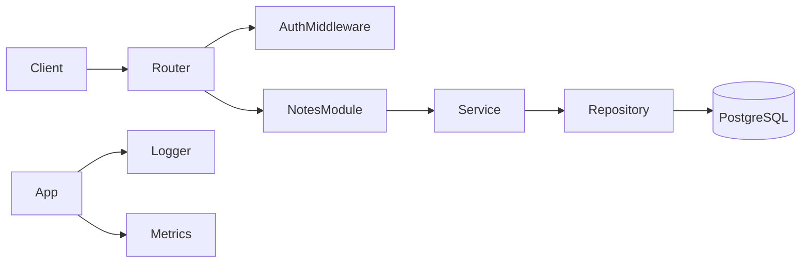

# prod-go

A production-minded starter for a Go modular monolith API. It takes a boring, explicit approach: standard library HTTP, PostgreSQL via pgx, raw SQL only, structured `slog` logging, versioned routes, and a layered architecture that is easy to follow and extend.

## Features

- HTTP server using Go 1.26's standard library routing and `net/http`
- PostgreSQL connection pooling with `pgxpool`
- User and auth flows with hashed passwords and JWT access tokens
- Notes resource with ownership checks and version-aware updates
- JSON response helpers and health/readiness/version endpoints
- Docker and Compose setup for local development
- CI-friendly Makefile and starter docs

## Quick start

```bash
cp .env.example .env
make build
make run
```

Then visit:

- http://localhost:8080/healthz
- http://localhost:8080/readyz
- http://localhost:8080/version

## Architecture diagram



## Folder map

- `cmd/api` - entrypoint for the HTTP API
- `cmd/migrate` - migration runner for schema updates
- `internal/app` - composition root and server lifecycle
- `internal/config` - environment-driven configuration
- `internal/platform` - shared infrastructure: logger, security, database
- `internal/modules/auth` - registration, login, token refresh, me
- `internal/modules/users` - user entity and interfaces
- `internal/modules/notes` - note domain and repository contract
- `migrations` - SQL migrations
- `deploy` - Docker and Compose configuration
- `docs` - architecture and onboarding guides

## Environment variables

| Name                   | Example                 | Purpose                          |
| ---------------------- | ----------------------- | -------------------------------- |
| `APP_ENV`              | `development`           | Runtime profile                  |
| `HTTP_ADDR`            | `:8080`                 | Bind address                     |
| `DATABASE_URL`         | `postgres://...`        | PostgreSQL connection string     |
| `JWT_SECRET`           | `...`                   | Signing secret for access tokens |
| `JWT_ISSUER`           | `prod-go`               | JWT issuer claim                 |
| `JWT_AUDIENCE`         | `prod-go`               | JWT audience claim               |
| `ACCESS_TOKEN_TTL`     | `15m`                   | Access token lifetime            |
| `REFRESH_TOKEN_TTL`    | `720h`                  | Refresh token lifetime           |
| `LOG_LEVEL`            | `INFO`                  | `slog` level                     |
| `LOG_FORMAT`           | `json`                  | `json` or `text`                 |
| `CORS_ALLOWED_ORIGINS` | `http://localhost:3000` | Allowed origins                  |
| `RATE_LIMIT_RPS`       | `10`                    | Request rate limit               |
| `RATE_LIMIT_BURST`     | `20`                    | Burst size                       |
| `METRICS_ADDR`         | `:9090`                 | Prometheus endpoint              |

## Example requests

```bash
curl -X POST http://localhost:8080/api/v1/auth/register \
  -H 'Content-Type: application/json' \
  -d '{"email":"user@example.com","password":"strong-password-123"}'

curl -X POST http://localhost:8080/api/v1/auth/login \
  -H 'Content-Type: application/json' \
  -d '{"email":"user@example.com","password":"strong-password-123"}'

curl -X GET http://localhost:8080/api/v1/auth/me \
  -H 'Authorization: Bearer <token>'
```

## Makefile

```bash
make help
make build
make test
make lint
make ci
make docker-up
make docker-down
```

## Dependency justification

| Dependency                 | Why it is here                                     |
| -------------------------- | -------------------------------------------------- |
| `pgx/v5`                   | PostgreSQL driver with pooling and raw SQL support |
| `goose`                    | database migrations with versioned SQL             |
| `jwt/v5`                   | JWT signing and validation                         |
| `argon2` via `x/crypto`    | password hashing with OWASP-aligned defaults       |
| `prometheus/client_golang` | metrics endpoint and instrumentation               |

## Production checklist

- terminate TLS in front of the app
- keep secrets in environment providers, not `.env` files in source control
- back up PostgreSQL regularly
- run migrations explicitly in deployment pipelines
- tune database pooling and rate limits to your workload
- enable log shipping and alerting for 5xx errors and DB latency

## Known limitations

- This template is intentionally small and beginner-friendly; it does not include a full RBAC system or distributed job runner.
- Many advanced requirements such as redis-backed rate limiting or OpenTelemetry are represented as seams rather than full implementations.
- The project expects a configured PostgreSQL instance for real application behavior.
