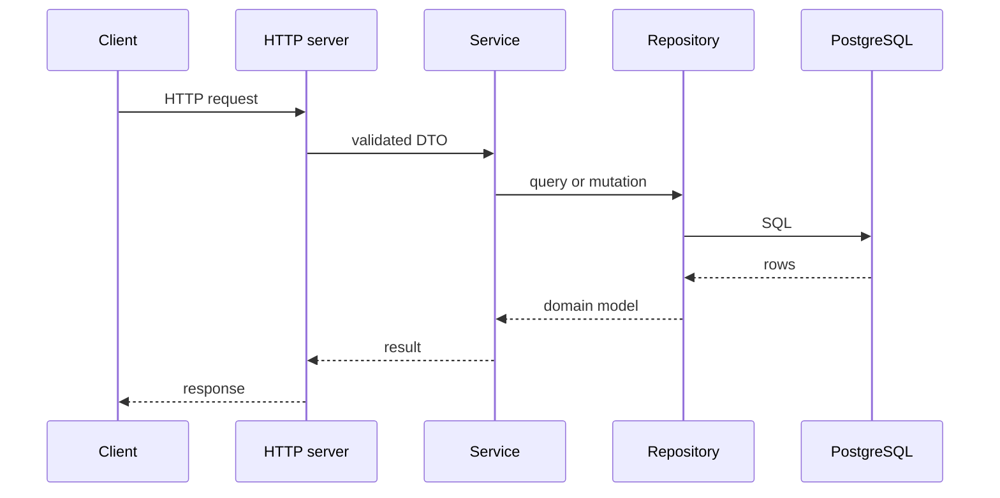
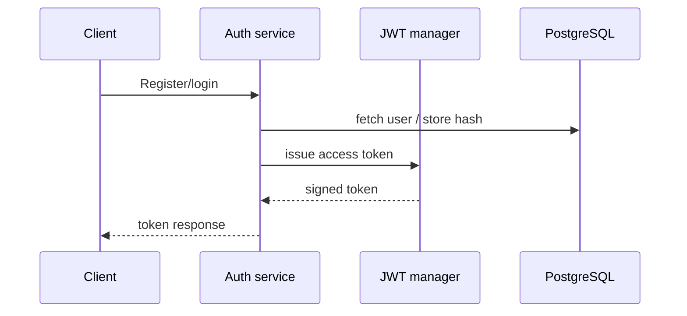

# Architecture

This repository follows a modular monolith with three internal module areas: `auth`, `users`, and `notes`.

## Layering

- domain packages define data structures and repository interfaces
- service packages contain business rules
- transport code handles HTTP concerns
- infrastructure packages manage persistence, logging, security, and config

## Dependency rules

The project is intentionally small, but the boundaries are meaningful:

- internal modules should not import each other directly
- service code depends on interfaces, not concrete implementations
- database access stays inside the platform and repository packages
- HTTP packages stay at the edge

## Request lifecycle

## Auth flow

## Observability seams

- logs use `slog` and can be switched between JSON and text output
- metrics can be published on a dedicated port
- the app exposes `/healthz` and `/readyz` separately to support orchestration
- OpenTelemetry hooks can be added in the middleware layer without changing domain logic
